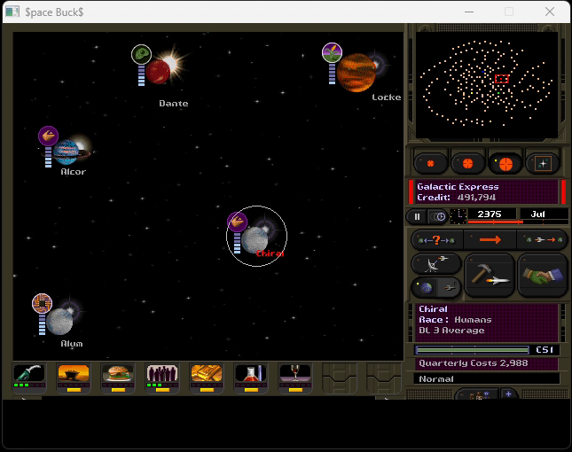
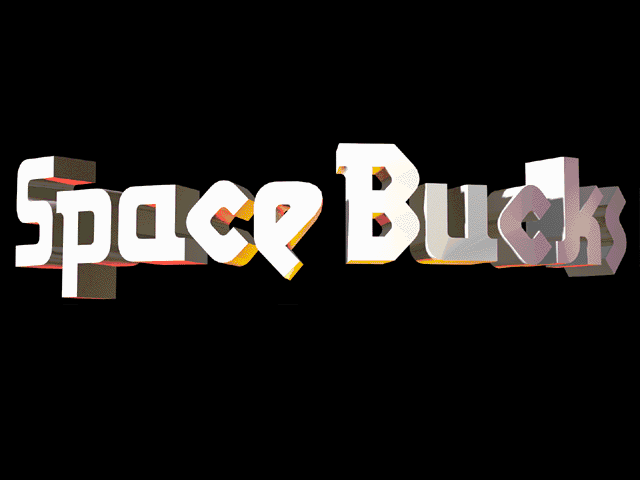
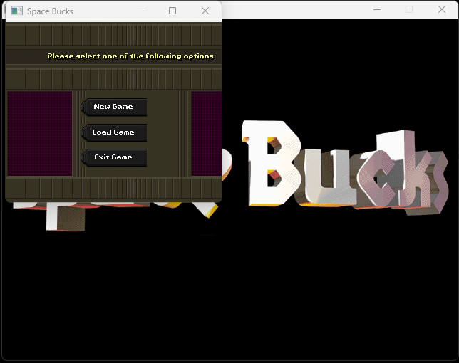
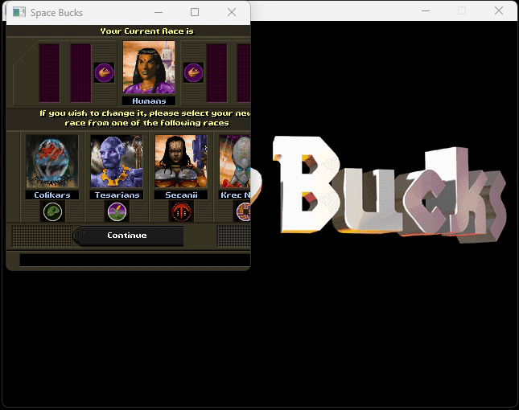
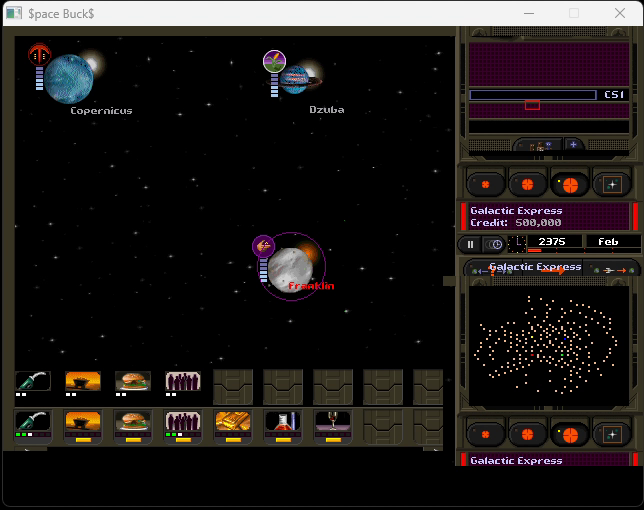

# Space Bucks — Static Recompilation

Static recompilation of **Space Bucks** (Impressions / Sierra On-Line, 1996),
the Windows 3.1 space trading game, from its shipping 16-bit (NE) executable
to native C that runs as a Windows program: no emulator, no Windows 3.1.
`SPACEBUC.EXE`, built with Borland C++ (42 code segments, 784 KB), is lifted
by pcrecomp's NE front end, with its own code map and no IDA, and runs on its
Win16 host, which answers KERNEL, USER, GDI, WinG and MMSYSTEM with Win32. The
third-party DLLs the game ships are answered here: Miles (`WAIL16`, silent for
now) and Borland's BWCC dialogs.

Built on the [pcrecomp](https://github.com/sp00nznet/pcrecomp) toolchain,
branch **`pcrecomp-ne-spacebucks`** (not yet merged into `main`), in its shared
house style, with the layout of the [Catz](https://github.com/sp00nznet/catz-recomp) recomp.

## Getting Started

You need **your own copy of Space Bucks**: the CD, a copy of it, or an `.iso`
of it. Nothing from the game is in this repository or downloaded for you;
everything is built on your machine from your copy. There is no installer
release yet.

### The setup scripts

1. Download this repository (the green **Code** button, then **Download ZIP**)
   and unzip it somewhere with 700 MB free.
2. Windows: double-click **`Setup.cmd`**. (Linux and macOS: not yet; `setup.sh`
   says so.)
3. Play with **`Space Bucks.cmd`** in that folder.

The script checks for Python 3.10+ with `capstone`, CMake, Ninja, MSYS2's
MinGW-w64 gcc and git, and **asks** before installing any of them. It fetches
pcrecomp beside this folder on branch `pcrecomp-ne-spacebucks` (an existing
checkout on another branch is left alone, and it tells you what to run). It
finds the CD in your drives or asks for it (`-GameDir E:\` or
`-GameDir spacebucks.iso` skips the question, `-Yes` answers yes to every
install), copies it into `game\`, lifts the game and builds
`build\spacebucks.exe`. A rerun skips finished steps; if it stops, it says why
in one sentence and the details are in `setup.log`.

Building by hand, step by step, is in **[docs/building.md](docs/building.md)**.

## Status

**v0.2.0, early alpha: in game.** New Game runs the setup and the company's
first months play out; clicks on the play screen work. Playing it (trading,
building ships) is not checked yet.

| Stage | State |
|---|---|
| Version recompiled | `SPACEBUC.EXE`, the CD release (1,360,283 bytes) |
| Lift (`tools/relift.py`) | 17,668 functions, 0 unresolved calls, pcrecomp's own code map (no IDA) |
| Startup, the INI, the "CD", WinG, the palette | run |
| Logo, credits (palette fades), title, opening menu (`OPEN0`) | run |
| New game: company name, color, race, difficulty | runs |
| The game: galaxy view, star map, credit, the clock running | runs, in color |
| Clicks on the play screen | work: hover text, and the trade-route button opens route mode (its side panels draw out of place) |
| Playing: trading, building ships | not checked yet |
| Scripted input (`RECOMP_INPUT`) | clicks and keys, for unattended runs |
| Sound (Miles) | a silent driver: every sound "plays" and ends at once |
| Videos (Smacker `.SMK`) | not yet: `SmackOpen` fails and the game skips them |
| Headless mode, conformance harness | not yet ([ROADMAP.md](ROADMAP.md)); runs are checked by hand |

[docs/bringup.md](docs/bringup.md) is the log of each wall and its fix.

## Screenshots

Real output of `build\spacebucks.exe`, recompiled code throughout:

| | |
|---|---|
|  |  |
|  |  |

## Documentation

- [docs/building.md](docs/building.md): building by hand, the toolkit branch, netlab
- [docs/bringup.md](docs/bringup.md): every wall so far and its fix, and the debugging aids
- [ROADMAP.md](ROADMAP.md), [CHANGELOG.md](CHANGELOG.md), [CONTRIBUTING.md](CONTRIBUTING.md)

## Contributors

See **[CONTRIBUTORS.md](CONTRIBUTORS.md)**.

## License

MIT for this repository's own code ([LICENSE](LICENSE)). Space Bucks is
© 1996 Sierra On-Line / Impressions; none of its files, and nothing generated
from them, is in this repository ([NOTICE.md](NOTICE.md)).
